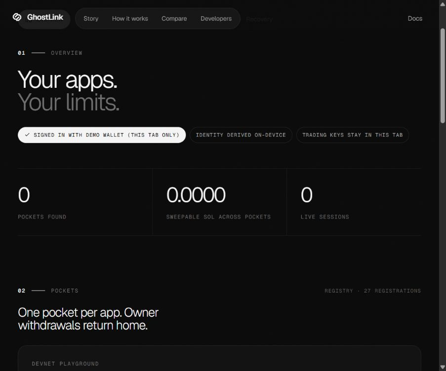
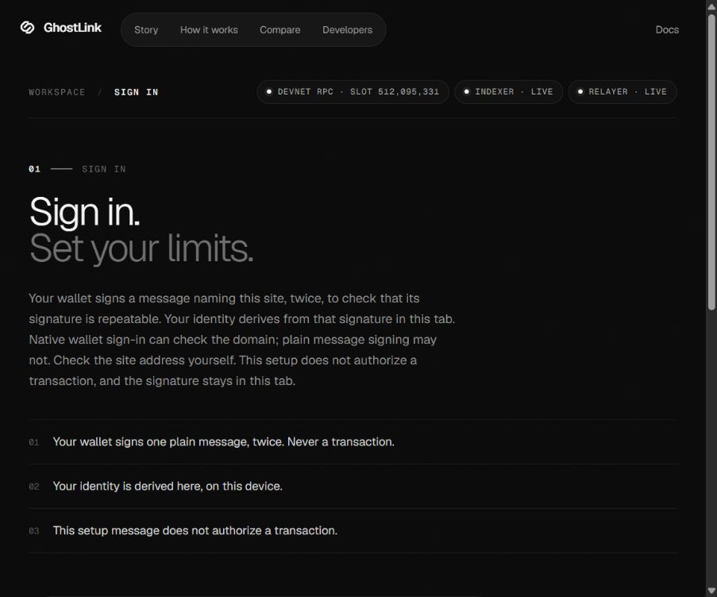
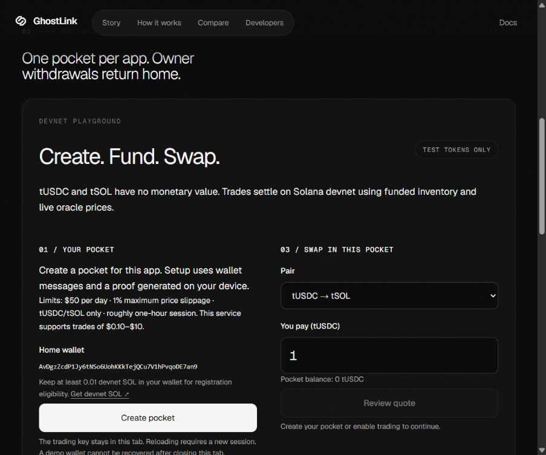
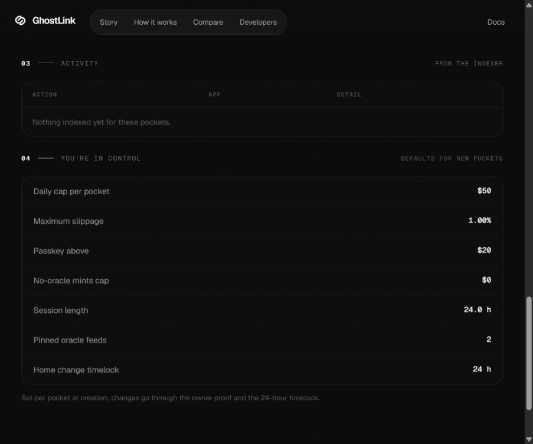
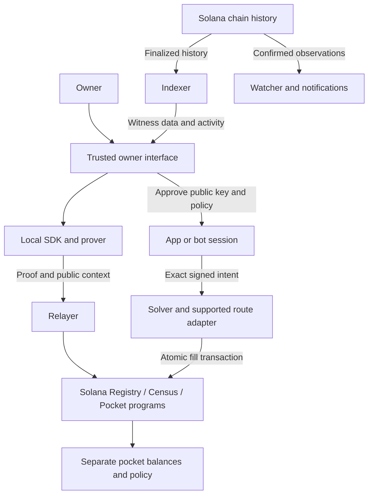

<h1 align="center">GhostLink</h1>

<p align="center"><strong>Prove what an app needs. Give it only the spending authority you approve.</strong></p>

<p align="center">Zero-knowledge identity · Separate spending pockets · Explicit session permissions · Solana</p>

<p align="center">
  <a href="https://ghostlink.software">Website</a> ·
  <a href="https://app.ghostlink.software">Devnet app</a> ·
  <a href="#app-walkthrough">App walkthrough</a> ·
  <a href="#build-and-install">Build &amp; install</a> ·
  <a href="LICENSE">Apache-2.0 source</a>
</p>

---

**GhostLink separates proving who you are from giving an application permission to spend.** A site can verify a supported identity or holdings claim. A trading application can receive a temporary session for a separate pocket, with an approved policy and a designated recovery destination. These are different permissions, and an integration must treat them that way.

> [!WARNING]
> **Experimental software. Test assets only.** The proving setup uses development keys and the code has not had an independent security audit. The public app is a preserved **V1 devnet demonstration**. The **V2 authorization / PocketV3 production candidate** lives on a separate development branch and is **localnet-only**. Neither is approved for real funds or mainnet. See [version status](#versions-and-release-status) before building.

<p align="center">
  
</p>

<p align="center"><sub>Actual hosted devnet interface, captured with a disposable demo identity on 17 October 2026. App source remains private. <a href="docs/media/screenshots/LICENSE.md">Screenshot terms</a>.</sub></p>

## Find your starting point

| You want to… | Start here |
| --- | --- |
| Understand the idea without reading code | [GhostLink in plain terms](#ghostlink-in-plain-terms) |
| See what a user actually does | [App walkthrough](#app-walkthrough) |
| Add login or a token gate to a site | [Login and access](#login-and-access) |
| Build a Telegram bot or trading integration | [Trading and bot integration](#trading-and-bot-integration) |
| Install the SDK or run the project | [Build and install](#build-and-install) |
| Review architecture and trust boundaries | [How it fits together](#how-it-fits-together) · [Privacy and security](#privacy-and-security) |
| See what is implemented and what remains | [Versions and release status](#versions-and-release-status) |
| Understand what you may copy | [Open source and licensing](#open-source-and-licensing) |

## GhostLink in plain terms

Think of a pocket as a separate account for one application. You choose what goes into it and approve the rules for using it. The application's session can request supported actions within those rules; it does not receive your main wallet's private key.

Identity is a separate part of the system. A zero-knowledge proof can establish membership in the GhostLink registry, or a supported claim about a recorded token balance, without including the wallet address in that login proof. A website still needs its own secure sign-in challenge and session management.

| Concept | What it means | What it does **not** mean |
| --- | --- | --- |
| **Identity** | A secret used locally to construct proofs | Something a bot backend should collect |
| **Proof** | Evidence of the specific claim and context checked by the verifier | Blanket permission to trade or a reusable bearer login |
| **Pocket** | A Solana program-derived account associated with an application | A normal wallet keypair that signs arbitrary transactions |
| **Session** | A temporary key authorized for supported pocket actions | Permanent access to the owner's main wallet |
| **Policy** | On-chain restrictions such as spending caps, expiry and trade conditions | A guarantee that every permitted trade is safe or profitable |
| **Home** | The designated destination for owner recovery | An arbitrary recipient chosen by a bot |
| **Relayer** | A service that submits supported operations and pays transaction fees | An owner of the identity secret |
| **Solver** | A service that builds and submits a supported fill transaction | A DEX, or permission to execute any route |

### Problems this design addresses

- **Overbroad trading authority.** A bot can use a scoped session instead of importing the owner's main wallet key. Losses inside the approved limits remain possible.
- **Mixing application funds with a main balance.** A pocket gives an application a separate balance. Other funded pockets need their own authorization.
- **Sharing more identity information than a claim requires.** A supported proof can establish the claim without putting a wallet address in the proof. Public activity and other identifiers can still create links.
- **Unclear recovery.** The owner has dedicated recovery and permission-management operations. Availability, proof generation and transaction submission still matter.
- **Uncertain transaction results.** The candidate persists operations and reconciles the original request after an interrupted response, rather than assuming that a timeout means nothing happened.

## App walkthrough

These screenshots show the **existing hosted V1 devnet app**, not the newer localnet candidate. They were captured directly from the running app with a fresh demo identity. No real wallet, personal balance, seed phrase or private application source is published here. Empty balances are intentional: these images illustrate the controls, not a successful trade.

### 1. Establish an identity on your device



The setup screen explains what the wallet is asked to do. The app checks repeatable signatures over a setup message and derives the identity in the page. That setup message is different from a transaction. Registration, pocket creation, funding and trading have their own steps.

The interface offers a real wallet or a disposable demo wallet, with optional passkey protection. The demo wallet is for exploration in that tab; closing it can make that demo identity unrecoverable. For a real identity, understand wallet and factor-recovery requirements first.

**Check the origin yourself.** Local proving does not isolate your secret from malicious JavaScript on the page. A trusted owner interface and secure deployment are part of the security boundary.

### 2. Understand the overview

The overview at the top of this README separates three facts:

| Indicator | How to read it |
| --- | --- |
| **Pockets found** | Pockets discovered for this identity and the origins being inspected |
| **Sweepable SOL** | The app's displayed recoverable SOL amount, not a complete valuation of all tokens |
| **Live sessions** | The app's view of active sessions; integrators must verify current chain state |

A new identity has no funded pocket or active session. Adding an application origin looks up its derived address; it does not grant that application spending permission.

### 3. Create, fund and review a swap



1. **Create a pocket.** Review the app, recovery home, session and limits. The owner produces the required proof locally and the service submits the opening operation.
2. **Fund it with test assets.** The demonstration offers test-token funding subject to its faucet limits. A normal integration needs an independently checked, wallet-approved deposit.
3. **Choose a supported pair and amount.** The demo uses `tUSDC` and `tSOL`, which have no monetary value. `tSOL` is a test token, not native SOL.
4. **Review the quote.** The service must have usable price data and sufficient inventory. The operation has exact amounts and limits.
5. **Wait for the actual outcome.** A submitted request or an HTTP response is not, by itself, confirmed settlement.

This is the **pre-creation state**: quote review is disabled until the necessary pocket/session is available. The limits shown are specific to this playground. Its roughly one-hour trading session is different from the separate defaults summary elsewhere on the page.

**Where does the trade happen?** The hosted demo settles against funded test inventory. The candidate has a separate experimental Jupiter/Raydium adapter. This screen is not evidence of live Jupiter routing or mainnet liquidity.

### 4. Inspect activity and limits



Activity is an indexer view of the chain. It can lag or be unavailable; a cached row is not authority to sign another trade.

The lower panel is labelled **defaults for new pockets**. It explains policy concepts, not the permissions of an arbitrary existing pocket. Read the actual pocket's policy. Home or policy changes follow the supported owner-proof and timelock flow rather than a silent dashboard edit.

The candidate's owner flows are documented in [owner consent][owner-consent] and [owner recovery][owner-recovery].

## How it fits together

This diagram describes the public protocol and candidate integration boundaries. The branded product interface is private.



### A trading session, end to end

| Step | Responsibility |
| --- | --- |
| **Request** | The app proposes a session and policy. A bot creates its own session key and sends only its public key to the owner interface. |
| **Consent** | The trusted interface verifies the app/deployment and shows the authority, expiry, home and limits. |
| **Prove** | The device constructs authorization. The candidate binds the exact policy, session kind and deployment. |
| **Activate** | The operation is submitted. The bot independently checks the confirmed pocket and its approved key/policy. |
| **Fund** | The user deposits the intended assets after checking destination, amount and instructions. |
| **Trade** | The session signs a specific intent; the solver constructs a supported transaction; the program checks authority, policy and actual delivery. |
| **Reconcile** | Unknown or pending outcomes stay unresolved until evidence establishes settlement. Restart preserves the original operation. |
| **Manage** | The owner uses supported revocation, recovery and delayed changes, subject to the documented recovery limitations. |

**A bot does not generate a new identity proof for every ordinary session-authorized trade.** Proofs establish identity/owner authorization; the temporary session signs the supported trading intents.

### Public components

| Component | Role |
| --- | --- |
| Registry program | Records identity commitments in a Merkle tree |
| Census program | Records supported token-balance snapshots |
| Pocket program | Holds balances and enforces supported policies and intents |
| Login / owner circuits | Prove the corresponding claims and owner actions |
| TypeScript SDK | Identity, sessions, proofs, pockets and integration helpers |
| React bindings | Unstyled integration components; no branded product UI |
| Server verifier | Checks proofs against expected context and supplied trusted roots |
| Reference services | Indexing, relaying, solving, funding and watching |
| Candidate bot package | Telegram authentication, consent and durable session/order handling |

## Login and access

GhostLink is not limited to trading. A site can ask for a supported proof without opening a spending pocket.

A secure sign-in integration issues a fresh backend challenge, verifies the proof's domain/claim/expiry against trusted roots, checks the proof-bound session signature, then consumes the challenge atomically before issuing its own session. A copied proof must not work as a bearer login token.

For a token gate, choose the mint, threshold and acceptable snapshot age. A historical holdings proof neither locks the tokens nor guarantees a current balance. A site or Telegram group that must track eligibility needs a recheck and access-removal policy.

These are **explicit integrations**, not a universal replacement for existing “Connect Wallet” buttons. A Pocket PDA cannot produce a normal wallet keypair's signature for an unrelated protocol. Read [integration boundaries][integrations] for the full responsibilities.

## Trading and bot integration

### Telegram bots and Mini Apps

The candidate includes a Node.js bot backend and consent protocol. It validates Telegram authentication, persists protected session/order state and checks confirmed permissions before signing.

**The bot operator must integrate it.** Installing an SDK does not add GhostLink to another company's Telegram bot. No named commercial bot integration, partnership or endorsement is claimed. [Compatibility research][bot-compatibility] separates researched providers from implemented adapters.

```text
Bot creates a temporary session key
          ↓ public key + requested permissions
Owner reviews the request in a trusted interface
          ↓ owner proof + confirmed activation
Bot verifies the on-chain authorization
          ↓ exact signed intent
Solver submits a supported atomic fill
```

The bot must not collect the owner's identity secret, proof witness, recovery factor or main wallet private key. A bot that accepts only imported normal wallet keys needs an integration; a pocket cannot be made compatible by exporting a key that does not exist.

### DEX routing

| Execution path | Current evidence |
| --- | --- |
| Hosted devnet playground | Funded inventory settlement with test tokens |
| Local-validator flow | Inventory-based atomic fill, with restart/recovery scenarios in the candidate |
| Candidate Jupiter / Raydium CP route | Experimental adapter tested locally with cloned programs and synthetic quotes/prices |
| Arbitrary DEX or launchpad | Not automatically supported; requires its own validation and acceptance evidence |

The program's fill boundaries check the expected output balance change. An unsuccessful fill must not leave a partial pocket spend. Route discovery, account validation, transaction size, lookup tables, fees and landing still need careful implementation. Read [Jupiter routing][jupiter] and [transaction recovery][transaction-recovery].

### Use-case coverage

| Use case | Production-candidate boundary |
| --- | --- |
| App trading sessions / liquid-token swaps | Supported local paths implemented; live route acceptance remains open |
| Bounded unpriced buys / tracked exits | Explicit opt-in policy implemented locally; losses within the approved budget remain possible |
| Telegram Mini App / Node bot consent | Reference backend and owner-controller primitives; real device/operator acceptance remains open |
| Website login / supported holdings gates | Proof primitives available; authentication and eligibility rechecks belong to the integrator |
| Several bots | Separate vetted origins/pockets; one active session per pocket |
| Copy trading, DCA, stop loss, take profit | Intent primitives available; durable triggers and strategy jobs are not delivered |
| Token-2022, arbitrary launchpads, lending, perps, NFTs | Not generally supported by the current swap contract |
| Merchant payments / unrestricted transfers | Not authorized by swap permissions |
| EVM / cross-chain operations | Not supported by changing an RPC URL; GhostLink is Solana-specific |

The [full compatibility matrix][readiness] is the authoritative checklist. SDK primitives are not evidence of a completed product integration.

## Build and install

### Default-branch source

Use **Node 22** and **pnpm 10.33.2**. Program and circuit tooling runs under Linux or WSL; follow the toolchain files and [setup guide](docs/SETUP.md).

```bash
git clone https://github.com/Ghostlink-Labs/ghostlink.git
cd ghostlink
pnpm install --frozen-lockfile
pnpm -r build
pnpm typecheck
pnpm test
```

For committed program fixtures, under Linux/WSL:

```bash
bash scripts/build-programs.sh
bash scripts/test-programs.sh
```

Public test proofs and verification data are included. Private deployment keys and a production proving ceremony are not. Regenerating development circuits changes proving/verifying artifacts together; follow the setup guide in a disposable development branch.

### Candidate SDK in another project

These packaging commands belong to the **candidate branch**, not the V1 default-branch release. Use a separate checkout and pin a reviewed commit for reproducible integration work:

```bash
git clone --branch codex/mainnet-sdk-foundation \
  https://github.com/Ghostlink-Labs/ghostlink.git ghostlink-candidate
cd ghostlink-candidate
pnpm install --frozen-lockfile
pnpm pack:sdk
pnpm test:package
```

Copy the archives and checksums from `artifacts/sdk/` to your own project:

```bash
npm install ./ghostlink-common-0.1.0.tgz ./ghostlink-sdk-0.1.0.tgz
```

**Package names do not imply an npm release.** Do not install an unrelated similarly named package. The [SDK guide][sdk] documents pnpm overrides, CommonJS imports, funding checks and the full authorization API.

The smallest public-key handoff looks like this:

```ts
import { softwareSession, sessionPublicKey } from '@ghostlink/sdk';

const botSigner = softwareSession();
const publicSession = sessionPublicKey(0, botSigner.key32);

// Only this public descriptor belongs in the consent handoff.
const requestedPublicKey = Array.from(publicSession.key32);
```

This creates a key; it does not authorize or execute a trade. An integration also needs authenticated consent, durable protected key storage, confirmed activation, nonce persistence, exact intent signing and outcome reconciliation.

For the candidate bot backend:

```bash
pnpm pack:bot
pnpm test:package:bot
```

The bot needs additional companion archives. Follow the [bot installation guide][bot]. Its SQLite-backed runtime supports Node `22.16+` within the 22 line, or Node 24; see that guide for details.

### Complete local flow

After preparing matching development artifacts in the [candidate setup guide][candidate-setup]:

```bash
bash scripts/localnet-e2e.sh

# Candidate finalized-indexer path with bounded work per tick:
INDEXER_FINALIZED_DRILL=1 bash scripts/localnet-e2e.sh
```

The candidate exercises registration, snapshots, bot consent, proving, verification, opening, funding, trading and owner recovery on a disposable validator. Synthetic Telegram data and local fills are fixtures, not certification of real devices or mainnet DEX routes.

## Privacy and security

### What is private—and what is public?

| Data or action | Boundary |
| --- | --- |
| Identity secret / proof witness | Must remain in the trusted proving environment |
| Login proof | Does not include the wallet address as an explicit login-proof field; the verifier still learns its public inputs |
| Registry / census activity | Recorded on-chain; proving privately does not erase registration history |
| Pocket, home, balances and transactions | Public on Solana |
| Deposits / recovery | Can link wallets and pockets |
| Network metadata | Services can observe requests and timing; this is not network anonymity |
| Bot session secret | Held and protected by the authorized bot/service, separately from the owner's secret |
| Open source | Enables inspection and reuse; it is not an audit or a safety guarantee |

The SDK runs in the caller's JavaScript context. It does **not** ship an isolated wallet extension or an origin-enforcing broker. Host security, trusted origins and secret handling are essential.

Policy limits reduce delegated authority; they do not eliminate market losses. A compromised session can still trade badly within its budget. There is one active session key per pocket; strategies sharing a pocket also share its authority constraints.

Read the [default-branch threat model](docs/THREAT-MODEL.md) or [candidate threat model][candidate-threat] for the revision you use. Report vulnerabilities through [SECURITY.md](SECURITY.md).

### Hosting responsibilities

Candidate services require approved-chain configuration and durable state. The indexer, relayer, solver and watcher have service-specific existing-state/identity checks. Deleting a database to make startup succeed can destroy essential history.

Keep credentials, keys, journals and backups private. Plan outages, exact-operation retries, recovery, retention, secret rotation and monitoring. A local example is not a production deployment procedure.

| Candidate guide | Covers |
| --- | --- |
| [Indexer][indexer-ops] | Finalized history, bounded backfill, pinned state, missing checkpoints and drain |
| [Relayer][relayer-ops] | Durable requests, reconciliation, fee/rent reservations and restore quarantine |
| [Solver][solver-ops] | Exact submissions, authority checks, state identity, budgets and shutdown |
| [Watcher][watcher-ops] | Observations, delivery acknowledgments and funded crank limits |
| [Actions][actions-ops] | Funding construction and independent client validation |
| [RPC][rpc-ops] · [Backup/restore][backup] | Approved providers, continuity, recovery and key-management boundaries |

These guides describe the **candidate**, not drop-in configuration for an older deployment.

## Versions and release status

| Surface | What it contains | Appropriate use |
| --- | --- | --- |
| [`main`](https://github.com/Ghostlink-Labs/ghostlink/tree/main) | Published V1 technology baseline and this guide | Source review and version-matched development/test use |
| [Hosted devnet app](https://app.ghostlink.software) | Private interface on the preserved V1 deployment | Exploring the test-token experience |
| [Production candidate](https://github.com/Ghostlink-Labs/ghostlink/tree/codex/mainnet-sdk-foundation) | V2 authorization, PocketV3, bot integration and operations hardening | Disposable localnet testing and review |
| Mainnet release | Not approved | Do not use either development setup with real funds |

V2 changes the login-proof context and uses `open_session_v2`. PocketV3 has a different discriminator/layout and **3,293-byte** accounts. The V1 baseline uses **2,089-byte** Pocket accounts. Clients and account formats are not interchangeable. Do not deploy the candidate over the preserved program or assume existing accounts have migrated.

See [V2 authorization][adr-v2], [bounded speculative policy][adr-v3] and [the original migration decision](docs/adr/0002-open-source-review.md).

### Evidence and remaining work

The candidate has unit, installed-package, circuit, Rust/SBF, LiteSVM and disposable-validator checks. Interrupted replies, recovery, state loss and shutdown have dedicated regressions. Inspect [CI for the exact revision](https://github.com/Ghostlink-Labs/ghostlink/actions), not a green result for another branch.

Release gates still include actual supported provider/route responses; real Telegram/wallet devices and operator adoption; archival continuity and independent history reconciliation; coordinated migration/restore; representative load and monitoring; strategy/budget operations; an independently verified proof ceremony; external security review; deployment governance and an authorized capped pilot.

The [readiness document][readiness] tracks these gates. No universal bot compatibility or completed mainnet readiness is claimed.

## Repository map

```text
programs/       Solana programs, verifier and integration tests
circuits/       Login/owner circuits and public test fixtures
packages/       Shared encodings, SDK, React, prover and verifier
services/       Indexer, relayer, solver, Actions, watcher and E2E
docs/           Setup, protocol decisions and technical guides
docs/media/     Four reviewed screenshots; separate image terms
```

The candidate additionally contains the bot package and expanded integration/operations guides. App source, website source, design-system files, editable branding, credentials and internal handoffs are not included.

## Open source and licensing

**The technology is open source. The complete GhostLink hosted product is not.**

| Material | Terms |
| --- | --- |
| Public protocol, circuits, SDKs, reference-service source and technical documentation | [Apache-2.0](LICENSE), except separately marked files |
| Four app screenshots | [Documentation-image permission](docs/media/screenshots/LICENSE.md); excluded from the Apache source grant |
| GhostLink name, logos and brand identifiers | [Brand policy](BRAND_POLICY.md); no general trademark license |
| Private website/app source and unpublished design assets | Not distributed or licensed by this repository |
| Third-party dependencies | Their respective licenses and notices |

Apache-2.0 permits copying, modification, redistribution and commercial use under its conditions. It requires the relevant license/attribution notices and notices of modified files; it does not require every derivative product to publish its source. See [LICENSE](LICENSE) and [LICENSING.md](LICENSING.md).

**A “no copying” restriction on the code would conflict with calling it open source.** GhostLink publishes reusable technology while keeping product source private and limiting rights to the screenshots and branding. Apache-2.0 grants no general trademark rights. Prior Apache-licensed copies cannot simply have their granted rights withdrawn by changing this README. See the [Open Source Definition](https://opensource.org/osd) and [Apache-2.0](https://www.apache.org/licenses/LICENSE-2.0.html).

You may truthfully describe an integration and preserve attribution. Do not present a fork as the official GhostLink service or imply endorsement. The [brand policy](BRAND_POLICY.md) distinguishes descriptive references from branding another product.

## Contribute

Start with [CONTRIBUTING.md](CONTRIBUTING.md), the setup guide and the threat model for your branch. Useful contributions include reproducible bug reports, authorization/persistence regressions, adapter validation and clearer documentation.

Keep secrets, real keys, private app source and internal notes out of issues, pull requests and Git history. For security issues, use [the private reporting procedure](SECURITY.md). Explain the changed behavior, tested revision and limitations of the evidence.

<p align="center"><sub>Built for inspection, explicit permissions and careful integration.</sub></p>

[sdk]: https://github.com/Ghostlink-Labs/ghostlink/blob/codex/mainnet-sdk-foundation/packages/sdk/README.md
[bot]: https://github.com/Ghostlink-Labs/ghostlink/blob/codex/mainnet-sdk-foundation/packages/bot/README.md
[integrations]: https://github.com/Ghostlink-Labs/ghostlink/blob/codex/mainnet-sdk-foundation/docs/INTEGRATIONS.md
[bot-compatibility]: https://github.com/Ghostlink-Labs/ghostlink/blob/codex/mainnet-sdk-foundation/docs/BOT-COMPATIBILITY.md
[readiness]: https://github.com/Ghostlink-Labs/ghostlink/blob/codex/mainnet-sdk-foundation/docs/MAINNET-READINESS.md
[jupiter]: https://github.com/Ghostlink-Labs/ghostlink/blob/codex/mainnet-sdk-foundation/docs/JUPITER-ROUTING.md
[transaction-recovery]: https://github.com/Ghostlink-Labs/ghostlink/blob/codex/mainnet-sdk-foundation/docs/TRANSACTION-RECOVERY.md
[owner-consent]: https://github.com/Ghostlink-Labs/ghostlink/blob/codex/mainnet-sdk-foundation/docs/OWNER-CONSENT.md
[owner-recovery]: https://github.com/Ghostlink-Labs/ghostlink/blob/codex/mainnet-sdk-foundation/docs/OWNER-RECOVERY.md
[candidate-setup]: https://github.com/Ghostlink-Labs/ghostlink/blob/codex/mainnet-sdk-foundation/docs/SETUP.md
[candidate-threat]: https://github.com/Ghostlink-Labs/ghostlink/blob/codex/mainnet-sdk-foundation/docs/THREAT-MODEL.md
[indexer-ops]: https://github.com/Ghostlink-Labs/ghostlink/blob/codex/mainnet-sdk-foundation/docs/INDEXER-OPERATIONS.md
[relayer-ops]: https://github.com/Ghostlink-Labs/ghostlink/blob/codex/mainnet-sdk-foundation/docs/RELAYER-OPERATIONS.md
[solver-ops]: https://github.com/Ghostlink-Labs/ghostlink/blob/codex/mainnet-sdk-foundation/docs/SOLVER-OPERATIONS.md
[watcher-ops]: https://github.com/Ghostlink-Labs/ghostlink/blob/codex/mainnet-sdk-foundation/docs/WATCHER-OPERATIONS.md
[actions-ops]: https://github.com/Ghostlink-Labs/ghostlink/blob/codex/mainnet-sdk-foundation/docs/ACTIONS-OPERATIONS.md
[rpc-ops]: https://github.com/Ghostlink-Labs/ghostlink/blob/codex/mainnet-sdk-foundation/docs/RPC-OPERATIONS.md
[backup]: https://github.com/Ghostlink-Labs/ghostlink/blob/codex/mainnet-sdk-foundation/docs/BACKUP-RESTORE.md
[adr-v2]: https://github.com/Ghostlink-Labs/ghostlink/blob/codex/mainnet-sdk-foundation/docs/adr/0003-session-authorization-v2.md
[adr-v3]: https://github.com/Ghostlink-Labs/ghostlink/blob/codex/mainnet-sdk-foundation/docs/adr/0004-bounded-speculative-trading.md
